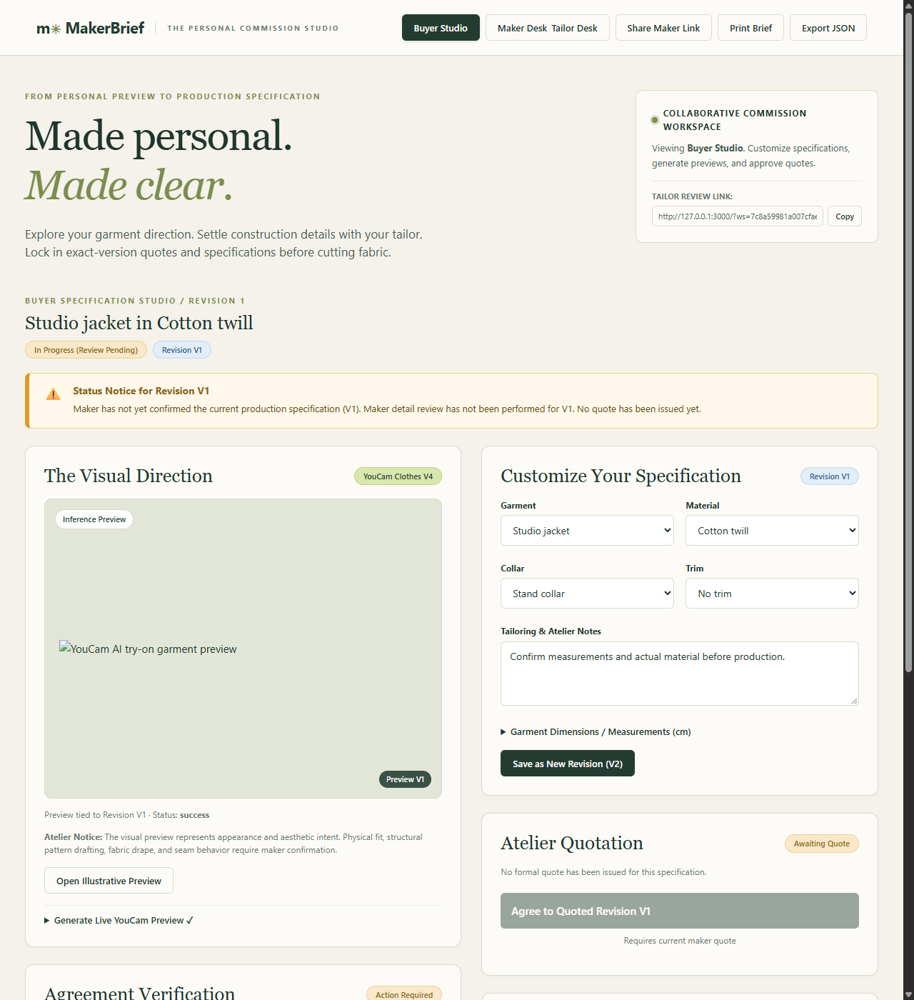
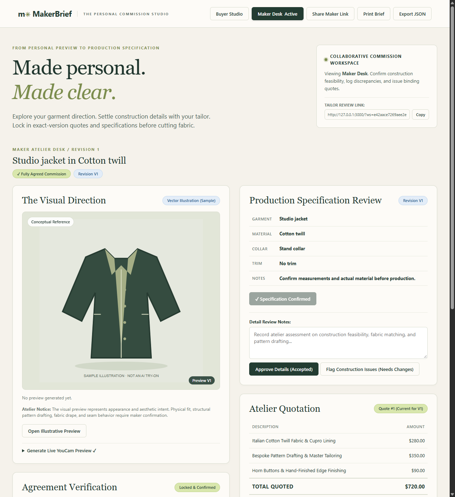
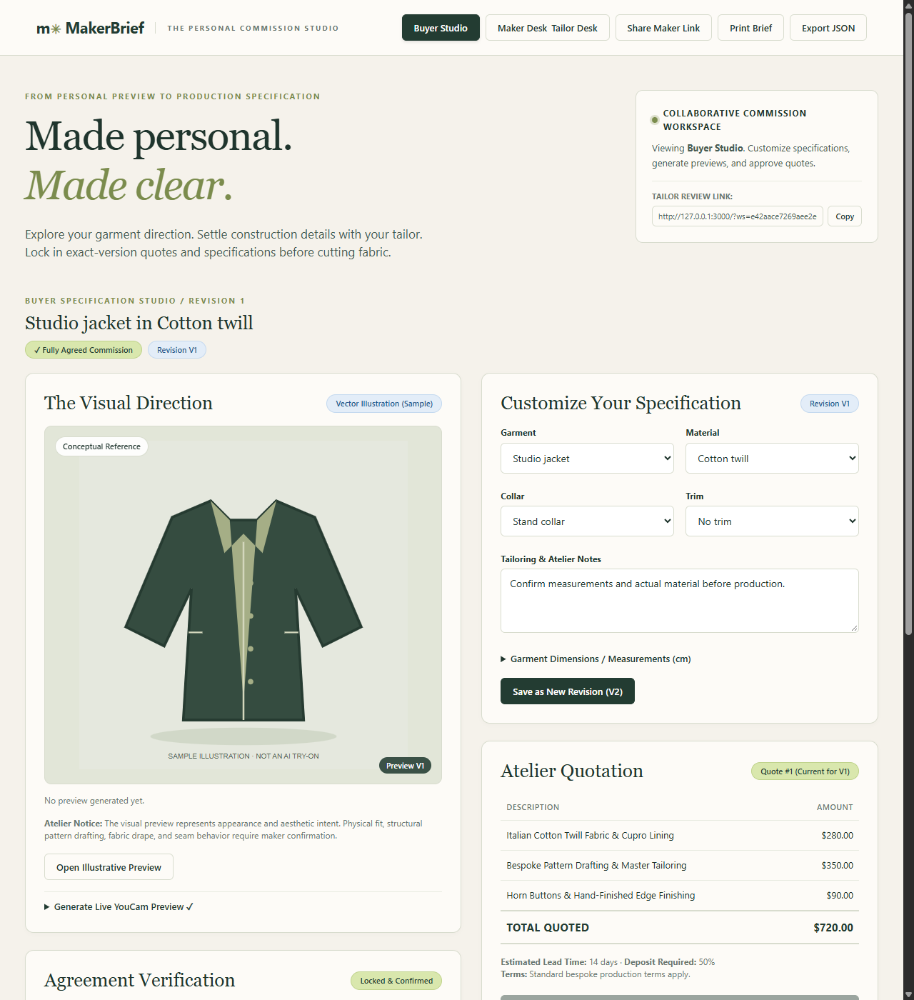
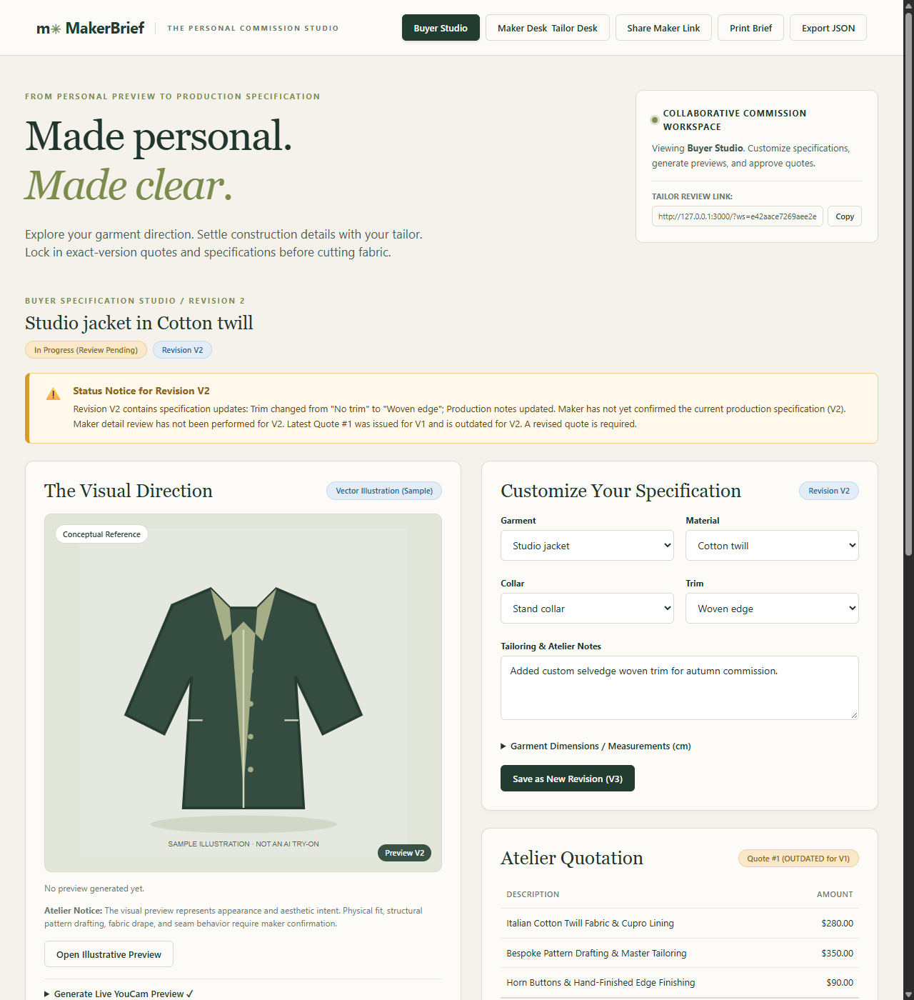

# MakerBrief · The Personal Commission Studio

> **Made personal. Made clear.**  
> Built for the **YouCam API Skin AI & eCommerce VTO Hackathon**.  
> Connecting personal AI garment try-ons to maker-reviewed specifications, structured quotes, and exact-version agreements.

---

## 🌟 The Core Idea

Virtual try-on (VTO) is powerful for exploring appearance, but an image is **not** proof of physical fit, fabric drape, pattern construction, structural stability, or tailoring feasibility.

**MakerBrief** establishes an explicit, auditable bridge between an exploratory virtual try-on preview and a bespoke commission agreement:

$$\text{Buyer preferences} \longrightarrow \text{Personal VTO Preview} \longrightarrow \text{Maker detail review} \longrightarrow \text{Production specification} \longrightarrow \text{Formal quote} \longrightarrow \text{Exact-version agreement}$$

### The Core Demonstration
1. **Create Brief & Preview**: The buyer configures outerwear specifications, enters measurements, and generates a personal try-on via **YouCam Clothes V4**.
2. **Resolve Details with Tailor**: The tailor accesses their authenticated **Maker Desk** via a private link (`/?ws=...&makerKey=...`), confirms construction feasibility, and logs physical discrepancies (e.g. pattern lapel differences vs. preview).
3. **Issue Binding Quote & Agree**: The tailor issues a formal quotation with itemized lines and lead times. The buyer reviews and locks in agreement.
4. **Change Specification**: The buyer changes a specification (e.g., collar or trim to *Woven edge* in V2).
5. **Automatic Invalidation**: Instantly, Quote #1 and prior approvals become **outdated**. The system explains the exact blockers to both parties.
6. **Re-quote & Re-approve**: The tailor reviews V2, issues Quote #2, and both parties agree to the revised commission.

---

## 📸 Screenshots & Workflow

### 1. Buyer Studio with Live YouCam Clothes V4 Try-On

*Real inference preview generated via Perfect Corp's Clothes V4 API, tied to Revision V1 with explicit atelier provenance warnings.*

### 2. Collaborative Maker Desk

*Tailor perspective authenticated via cryptographic token, enabling specification confirmation, discrepancy logging, and quotation issuing.*

### 3. Fully Agreed Commission

*Both parties lock in agreement against an exact quote ID and revision number.*

### 4. Automatic Invalidation on Specification Revision

*When a specification changes in V2, Quote #1 and prior approvals are immediately invalidated with explanatory feedback.*

---

## 🛠️ Architecture & Technology Stack

- **Zero-Dependency Native Node.js**: Built using pure Node.js ES modules (`node:http`, `node:crypto`, `node:fs`, `node:test`). No heavyweight frameworks or third-party runtime npm packages.
- **YouCam Clothes V4 S2S Integration**: Direct authenticated communication with Perfect Corp API gateway (`https://yce-api-01.makeupar.com/s2s/v2.0/task/cloth-v4`) with strict host allowlisting and bounded polling.
- **Dual-Role Object Authorization**: Workspaces maintain independent cryptographic keys (`buyerKey` and `makerKey`). The server strictly forbids buyers from issuing quotes or confirming feasibility, and forbids tailors from approving quotes on behalf of buyers.
- **Transactional Atomic Persistence**: State updates are written atomically to temporary files and renamed, backed by per-workspace concurrency mutex locks.
- **Atelier Design System**: Warm paper and deep forest ink aesthetics with full WCAG 2.1 AA compliant contrast and responsive desktop/mobile layouts.
- **Printable Atelier Production Sheet**: Built-in `@media print` engine generating clean, printable commission agreements with signature lines.

---

## 🚀 Quickstart

### Prerequisites
- Node.js 22 or later (verified on Node 22.13.1 and 24).
- No `npm install` needed—zero external dependencies!

### 1. Verify Codebase
```bash
npm test       # Runs 16 automated domain, HTTP, role authorization, and provider tests
npm run check  # Validates syntax for both server and browser entrypoints
```

### 2. Configure Environment
```bash
cp .env.example .env
```
Edit `.env` to enable live YouCam inference:
```env
HOST=127.0.0.1
PORT=3000
ENABLE_LIVE=true
YOUCAM_API_KEY=your_youcam_api_key_here
IMAGE_HOSTS=images.unsplash.com,upload.wikimedia.org,raw.githubusercontent.com
MAX_LIVE_JOBS=20
```
*(If `ENABLE_LIVE=false`, MakerBrief seamlessly runs in offline/sample mode with original conceptual illustrations so all collaboration and quoting workflows can be evaluated without spending credits).*

### 3. Start the Server
```bash
npm start
```
Open **`http://127.0.0.1:3000`** in your browser.

---

## 🔒 Security & Privacy Practices

- **Server-Side API Key Storage**: Credentials never touch client JavaScript or browser network traces.
- **Strict Image Host Allowlist**: Prevents SSRF and internal network scanning by requiring operator-approved hostnames.
- **CSRF & Origin Enforcement**: Mismatched cross-origin requests are rejected (HTTP 403).
- **Private Data Isolation**: Workspaces are isolated via unguessable 48-character hex identifiers and private cookie sessions.
- **Gitignored Secrets**: `.env` and runtime data directories are strictly excluded from source control.

---

## 📄 License

MIT License. Copyright (c) 2026 MakerBrief contributors.  
Third-party API use, photos, garments, and maker content require their own respective permissions.
